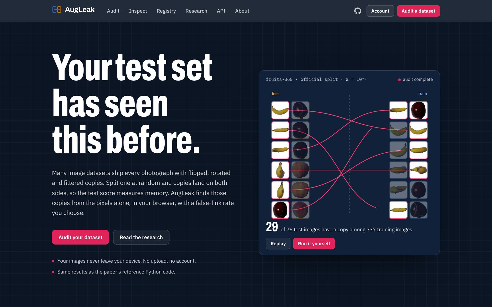
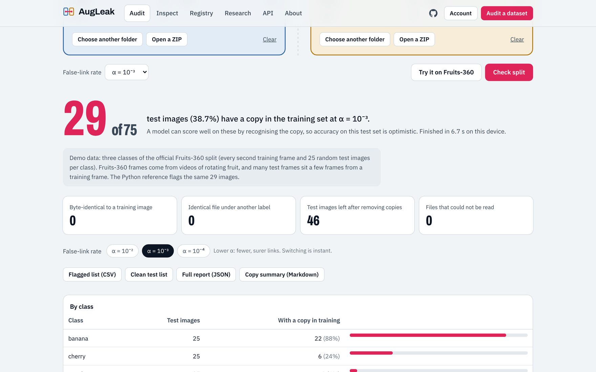
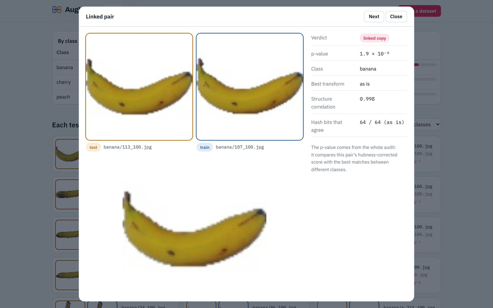
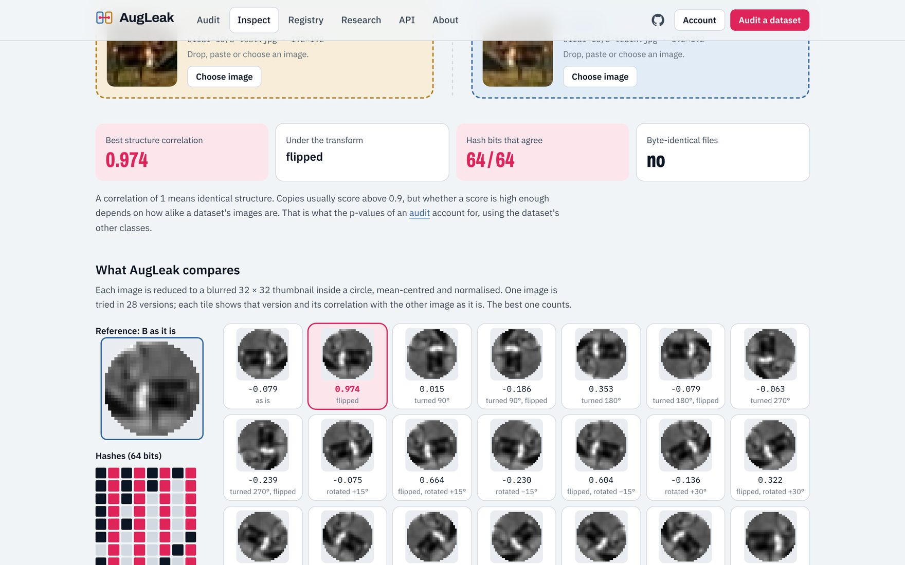
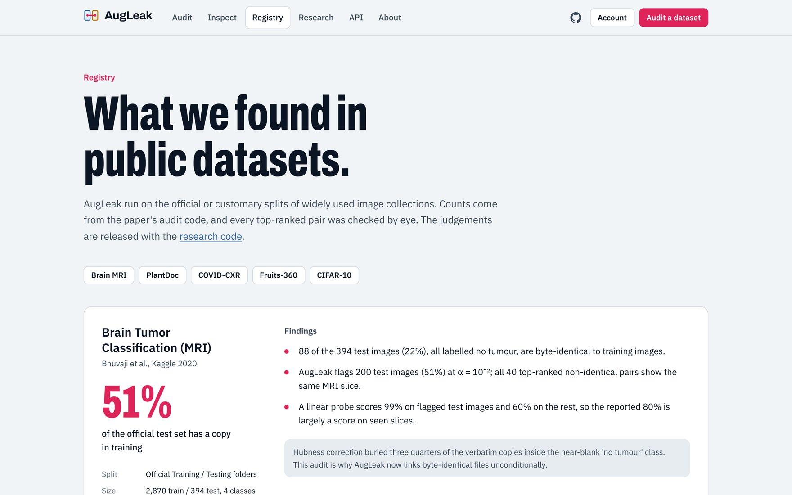
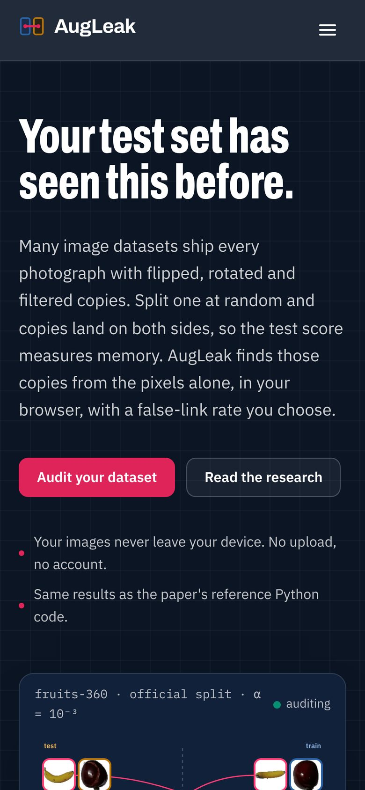
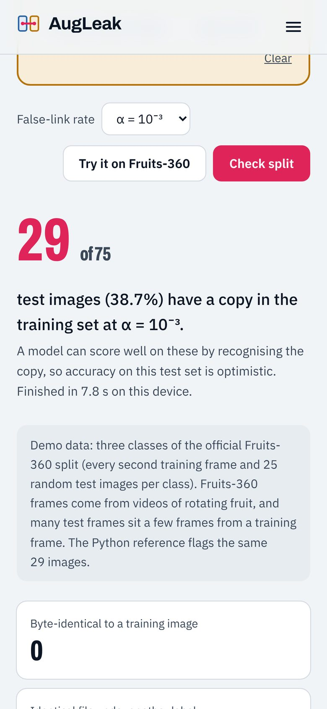
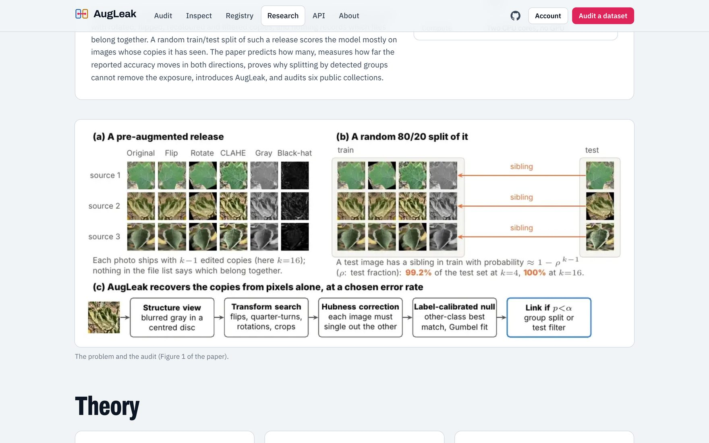

<p align="center">
  
</p>

<h1 align="center">AugLeak</h1>

<p align="center">
  <b>Find the test images your model has already seen.</b><br />
  A private, in-browser audit for image datasets: it finds the flipped, rotated, cropped and filtered copies that leak across a train/test split, from the pixels alone, at a false-link rate you choose.
</p>

<p align="center">
  <a href="https://augleak.vercel.app"><b>augleak.vercel.app</b></a>
  &nbsp;·&nbsp; <a href="https://augleak.vercel.app/audit?demo=1">Live demo</a>
  &nbsp;·&nbsp; <a href="https://augleak.vercel.app/registry">Dataset registry</a>
  &nbsp;·&nbsp; <a href="https://augleak.vercel.app/research">Research</a>
  &nbsp;·&nbsp; <a href="https://augleak.vercel.app/developers">API</a>
</p>

<p align="center">
  <a href="https://github.com/agarwalpranay02/augleak/actions/workflows/ci.yml"></a>
  <a href="https://github.com/agarwalpranay02/augleak/actions/workflows/security.yml"></a>
  
  
</p>

<p align="center">
  
</p>

Many public image datasets ship every photograph together with edited copies of it: flipped, rotated, colour-shifted, filtered. Nothing in the file list says which files belong together, so a random train/test split puts a copy of almost every test image into training, and the test score measures memory instead of generalisation.

AugLeak finds those copies without metadata. Give it a training folder and a test folder (or one folder before you split) and it compares every pair of images under 28 transforms, calibrates the scores against matches between classes, and reports which test images have a copy in training, with a p-value for each. Everything runs in the browser: the images are never uploaded.

## Results

Numbers from the accompanying paper; every one is generated by [`research/src/make_numbers.py`](research/src/make_numbers.py) from the files in [`research/results`](research/results).

| | |
|---|---|
| Accuracy a fine-tuned MobileNetV3 reports on a random split of CIFAR-Aug (16 copies per photo) | **98.2%** |
| The same model on fresh photographs it never saw | **73.6%** (EfficientNet-B0: 98.8% vs 75.0%) |
| Copy recovery, average precision on Leaf-B (AugLeak vs ImageNet-embedding baseline) | **0.76** vs 0.20 |
| Accuracy overstatement left after evaluation, naive split vs AugLeak's detected groups | **+7.7** vs **+1.1** points |
| Brain Tumor MRI (Kaggle): official test images with a copy in training | **51%**, including 88 byte-identical files |
| Browser engine vs Python reference on the demo split | the same 29 of 75 test images flagged; structure scores within one float16 step |

**What the audits found.** On five widely used public datasets: half of a brain-MRI test set is in its training set; 8.9% of PlantDoc's test set is compromised, including test images filed in training under a different label; an image-level split of a COVID chest X-ray collection overstates accuracy by 5.6 points; 8% of Fruits-360 test images are nearby frames of a training video; and 2.7% of the CIFAR-10 test set is flagged at α = 10⁻². Evidence for each, with example pairs, is in the [registry](https://augleak.vercel.app/registry).

## Features

<table>
<tr>
<td width="50%"></td>
<td width="50%"></td>
</tr>
<tr>
<td width="50%"></td>
<td width="50%"></td>
</tr>
</table>

- **Check a split.** Drop a training and a test folder (one sub-folder per class), or ZIP files of them. AugLeak flags every test image with a copy in training, shows each pair side by side with a blend slider, and lets you switch the false-link rate (α = 10⁻², 10⁻³, 10⁻⁴) instantly.
- **Find copy groups before you split.** Point it at one folder and it links copies into groups, then downloads a group-aware train/test split with a fixed seed, so no photograph lands on both sides.
- **Exports for papers and reviews.** Flagged pairs as CSV, the clean test list, a full JSON report and a Markdown summary you can paste into a paper or a review.
- **Catches what others miss.** Byte-identical files are always linked, including identical files filed under different labels, which usually means a labelling error.
- **Pair inspector.** Compare any two images and see all 28 transformed views, their correlations and the 64-bit perceptual hashes, to understand why a pair was linked.
- **Private by design.** Images are decoded and compared in Web Workers on your device, one per core; nothing is uploaded, and the audit needs no network once the page has loaded. Recent audit summaries (counts, never images) are kept only in your browser.
- **Free developer API.** Sign in, create a key and call `POST /api/v1/compare`, `POST /api/v1/features` or `GET /api/v1/exposure` from your own pipeline. Keys are hashed and peppered, with per-minute limits and monthly quotas.
- **A command-line tool for large datasets.** [`research/augleak_cli.py`](research/augleak_cli.py) runs the same detector on folders of any size: `scan`, `test` and `split`.

<p align="center">
  
  &nbsp;&nbsp;
  
</p>

## How it works

1. **Two pixel views.** Each image becomes a blurred grey 32 × 32 thumbnail inside a centred disc (a 732-number *structure* vector that survives colour changes, CLAHE, thresholding and gamma) and a 64-bit DCT perceptual *hash*.
2. **A transform search.** Every test image is tried in 28 versions (flips, quarter-turns, rotations up to 45° and crops) against every training image of its class; the best correlation counts. Hashes are searched over the 8 flips and quarter-turns.
3. **Calibrated p-values.** Scores are hubness-corrected (each image must single out the other), then compared with a null built from the class labels: an edited copy never changes class, so an image's best match in another class is an unrelated image. A Gumbel fit to those maxima gives a p-value per pair, and the two views are combined by Bonferroni. Pairs below α are linked.
4. **The same answer everywhere.** The browser engine is a line-by-line TypeScript port of the Python reference: Pillow's bilinear resampling, SciPy's Gaussian filter and rotation, Python's round-half-even crops and float16 rounding. [`apps/web/tests/parity.test.ts`](apps/web/tests/parity.test.ts) checks features, scores, p-values and flagged images against fixtures produced by the Python code.

<p align="center"></p>

## Tech stack

| Area | What's used |
|---|---|
| **Detection and statistics** | Structure and perceptual-hash views, 28-transform search, hubness correction, label-calibrated Gumbel null, Bonferroni combination, union-find grouping, exposure model 1 − ρ^(k−1) |
| **Research code** | Python, NumPy, SciPy, Pillow, PyTorch and timm (frozen MobileNetV3 / EfficientNet-B0 baselines and fine-tuning), scikit-learn, Matplotlib |
| **Frontend** | Next.js 16 (App Router, Turbopack, React Server Components), React 19.3, TypeScript, Tailwind CSS 4, Archivo and IBM Plex variable fonts |
| **In-browser engine** | Module Web Workers (one per core) for decoding, features and score blocks; a separate statistics worker; createImageBitmap and OffscreenCanvas decoding; SHA-256 via Web Crypto; JSZip for ZIP input; folder picker and drag-and-drop folder input; IndexedDB (idb-keyval) for history |
| **Backend** | Next.js route handlers, sharp for server-side decoding, better-auth (Google OAuth, email links), Drizzle ORM, PostgreSQL (Neon in production, PGlite locally), Zod validation, rate limiting (in-memory or Upstash) |
| **Security** | Strict nonce-based Content-Security-Policy with `strict-dynamic`, HSTS, frame-ancestors none, Permissions-Policy, same-origin CSRF guard, hashed and peppered API keys, upload size and type checks, CSP violation reporting |
| **Testing** | Vitest parity tests against the Python reference, Playwright end-to-end tests on desktop and mobile (every page, the demo audit, the API) |
| **CI/CD and supply chain** | GitHub Actions (lint, type-check, unit, build, end-to-end, Python parity), CodeQL, gitleaks, npm audit, pip-audit, Dependabot |
| **Platform** | Installable PWA with an offline service worker, Open Graph images, sitemap, Vercel hosting |

## Research behind it

AugLeak is the tool from the paper *Copies Across the Split: Pre-Augmented Datasets Silently Corrupt Test Accuracy, and How to Audit Them Without Metadata* (Pranay Agarwal, manuscript, 2026). The paper predicts how many test images a random split exposes, measures how far the reported accuracy moves, proves why splitting by detected groups cannot remove the exposure entirely, and audits public datasets. [`research/`](research) holds its code and results: one script regenerates every figure, table and in-text number of the paper. The paper will be linked here once it is public.

## Repository

```
apps/web/              Next.js app: pages, components, API routes
  src/lib/engine/      The detector in TypeScript: features, scores, statistics, Web Workers
  public/demo/         Fruits-360 demo split and its reference result
  tests/  e2e/         Vitest parity tests and Playwright end-to-end tests
  scripts/             Fixture generator that runs the Python reference
research/              The paper's code: augleak_cli.py, experiments, results, figure and table scripts
docs/                  Logo and screenshots
.github/               CI, security scanning, Dependabot
```

## Run it locally

```bash
cd apps/web
npm install
cp .env.example .env.local    # works as is: embedded Postgres, sign-in links printed to the console
npm run dev                   # http://localhost:3000
```

Tests: `npm test` for the parity tests (generate their fixtures first with `pip install -r ../../research/requirements.txt && python scripts/make_fixtures.py`); `npm run build && npm start`, then `npx playwright test` for end-to-end.

Command line, for datasets too large for a browser tab:

```bash
cd research
pip install -r requirements.txt
python augleak_cli.py test path/to/train path/to/test --out report/   # which test images have a copy in train?
python augleak_cli.py scan path/to/data --out report/                 # copy groups inside one release
python augleak_cli.py split path/to/data --test-frac 0.2 --out split/ # a group-aware split
```

## Guides

- [FREE_HOSTING.md](FREE_HOSTING.md): put it online at no cost on Vercel and Neon
- [research/README.md](research/README.md): reproduce every number in the paper
- [SECURITY.md](SECURITY.md): security design and how to report a problem

## Licence

Copyright © 2026 Pranay Agarwal. All rights reserved; free for research and education, see [LICENSE](LICENSE). Third-party components and datasets are credited in [NOTICE](NOTICE).

AugLeak gives statistical evidence, not certainty: detected copies are a lower bound, and the false-link rate is approximate on datasets with only two or three classes.
